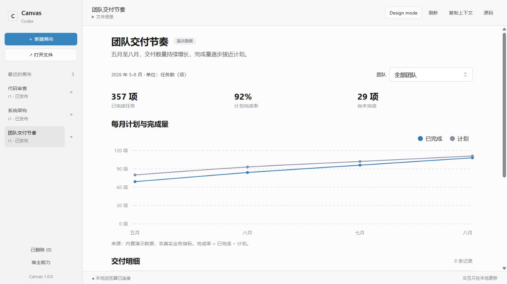
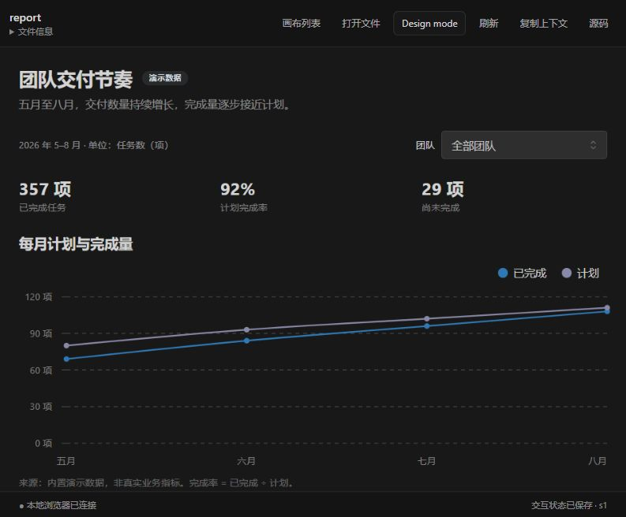
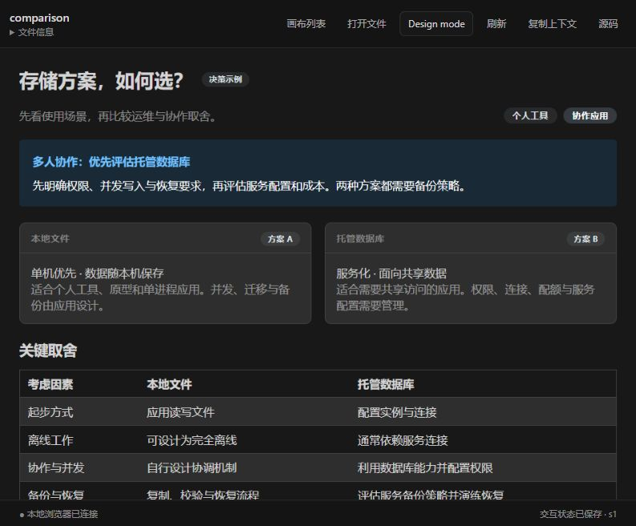
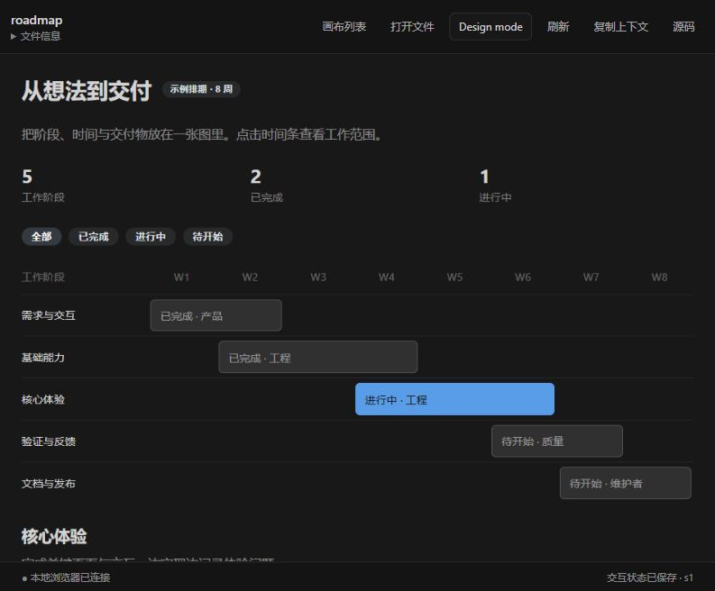
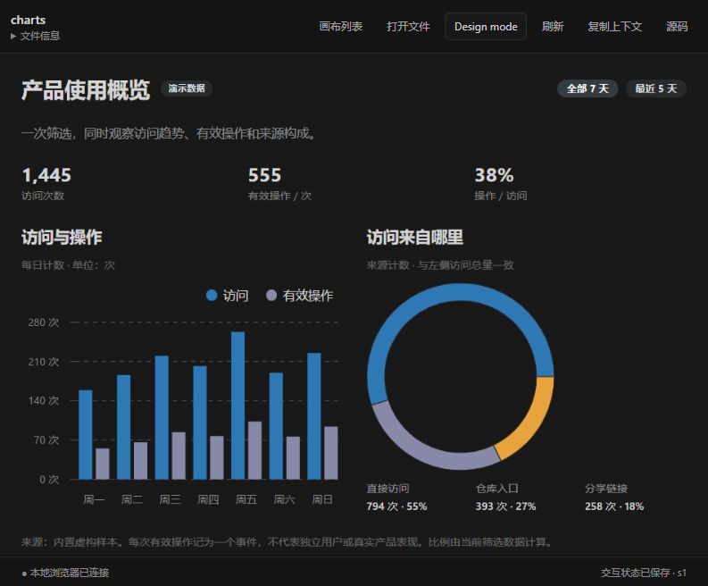
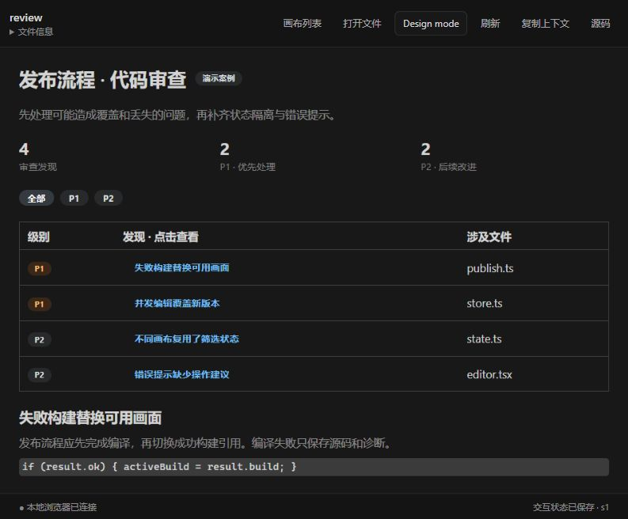
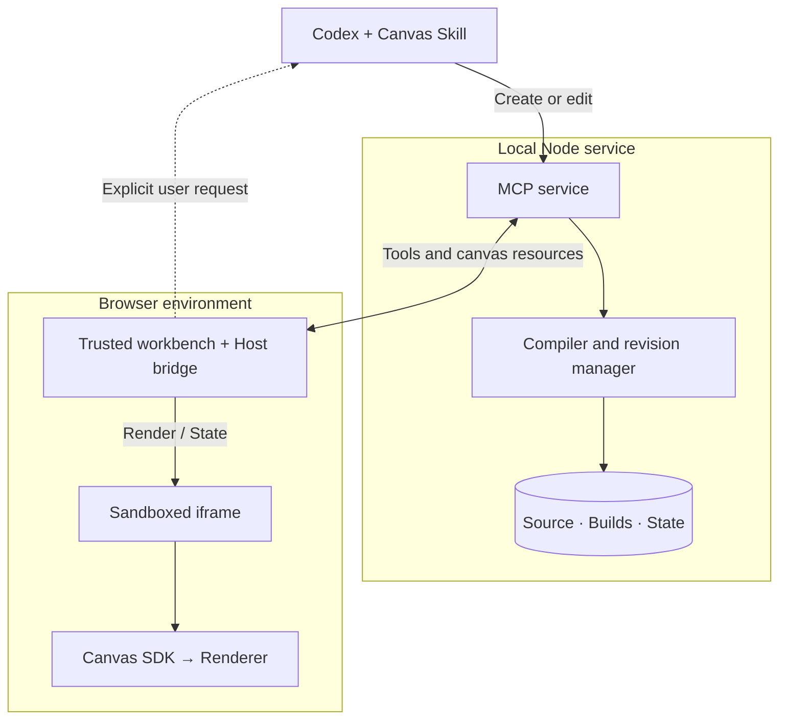

<div align="center">

# Codex Canvas

### Turn answers into canvases you can explore.

Create interactive reports, charts and architecture views in Codex. Select a part and refine it in natural language.

[中文](README.md) · **English**

[](CHANGELOG.md)
[](LICENSE)
[](package.json)

[Gallery](#gallery) · [Quick start](#quick-start) · [Install in Codex](#install-in-codex) · [How it works](#how-it-works) · [Contribute](#contribute)

</div>



<p align="center"><em>Actual running UI · Built-in sample data · Local browser mode</em></p>

Codex Canvas is an open-source plugin for **Codex desktop**. It uses MCP Apps to display canvases in supported host side panels, with a standalone local browser preview also available. Source, revisions and interaction state are stored locally, so a canvas can be reopened, explored and edited over time.

## Gallery

**Six scenarios. Six runnable source files.** Click an image to enlarge it or open its source. Run the examples as they are, or ask Codex to adapt them to your own content.

| Data report | System architecture |
|:---|:---|
| [](docs/assets/example-report.jpg) | [](docs/assets/example-architecture.jpg) |
| Filter by team to update metrics, trends and detail rows.<br>[View source →](examples/report.tsx) | Select a module to explore its responsibilities and boundaries.<br>[View source →](examples/architecture.tsx) |
| **Option comparison** | **Project timeline** |
| [](docs/assets/example-comparison.jpg) | [](docs/assets/example-roadmap.jpg) |
| Switch use cases to understand recommendations and tradeoffs.<br>[View source →](examples/comparison.tsx) | Filter phases by status and select a bar to see its scope.<br>[View source →](examples/roadmap.tsx) |
| **Everyday charts** | **Code review** |
| [](docs/assets/example-charts.jpg) | [](docs/assets/example-review.jpg) |
| Change the time range to update bars, a donut and totals together.<br>[View source →](examples/charts.tsx) | Filter by severity and inspect findings, files and suggestions.<br>[View source →](examples/review.tsx) |

Gallery images show running canvas content. Reports and charts use synthetic data; plans, comparisons and reviews are illustrative, not real project commitments or benchmark results. The examples currently use Chinese labels. See the [example guide](examples/README.md) for prompts and usage.

## Explore it. Then refine it together.

- **Explore beside the conversation** — Native panels on supported hosts, local browser previews, and light / dark themes.
- **Edit a specific part** — Design mode lets you select an element or its parent and attach an instruction.
- **Open TSX / JSX files** — Use single-file canvases built with the SDK; file watching updates the preview when source changes.
- **Keep progress and state** — Filters persist per canvas. Source is versioned, and failed compilation preserves the latest successful view.
- **Manage a local library** — Create, reopen, delete and restore canvases. Deleting a canvas does not delete its external source file.

### Design mode: point to it, then describe the change


Enable **Design mode → select content → enter an instruction**. Supported hosts can attach the selection to chat or send an edit request. In browser mode, copy the selection context and paste it into chat. Normal filters and selections do not start AI turns.

*Browser-mode screenshot: native chat actions are disabled without host messaging support. The pictured request was not sent.*

## Quick start

Requires **Node.js 22+** and **pnpm 11.25.0**. Clone the repository and start your first example:

```sh
git clone https://github.com/payAgain/codex-canvas.git
cd codex-canvas
npm install --global pnpm@11.25.0
pnpm install --frozen-lockfile
pnpm build
pnpm canvas open examples/report.tsx
```

Open the local preview URL printed by the command to use your first canvas. Substitute `examples/architecture.tsx`, `examples/charts.tsx` or another example path to explore more. Use `pnpm start` for the full workbench.

### Use it in Codex

After installing the plugin, describe the content you want:

> Use Codex Canvas to turn this delivery data into a report. Start with one conclusion, then show metrics, trends and details with a team filter. Keep sources visible and do not invent data.

> Open this TSX file with Codex Canvas and follow my subsequent source edits.

> Make an interactive comparison of these two options, with recommendations by use case, supporting evidence and open questions.

The bundled [Canvas Skill](skills/canvas/SKILL.md) guides Codex through writing, publishing and opening canvases. You can also use the workbench's file picker. **Ordinary file links in chat may open an external editor; use the Canvas opening tools for a preview.**

## Install in Codex

Requires **Codex desktop with plugin support** and a **Codex CLI** that provides `codex plugin`. After building above:

```sh
pnpm package:release
node scripts/check-package.mjs
```

Change into the printed **`releaseRoot`** directory, then register and install:

```sh
codex plugin marketplace add . --json
codex plugin add codex-canvas@codex-canvas-local --json
```

<details>
<summary>PowerShell: how do I enter releaseRoot?</summary>

Run from the repository root:

```powershell
$release = Get-Content .local/latest-release.json -Raw | ConvertFrom-Json
Set-Location $release.releaseRoot
```

`releaseRoot` is the generated marketplace directory, not the repository root. `check-package` installs locked dependencies and checks MCP startup and example compilation.

</details>

<details>
<summary>Already have portable.zip?</summary>

Extract it into a directory you intend to keep. From `plugins/codex-canvas/`, run:

```sh
npm ci --omit=dev --ignore-scripts --no-audit --no-fund
```

Return to the extraction root containing `INSTALL.md` and `.agents/`, then run the two `codex plugin` commands above. The portable archive excludes `node_modules`; dependency installation needs internet access.

</details>

Enable the plugin and start a new chat. If an existing chat still uses an older service, reload the plugin or restart Codex. See the [release guide](docs/RELEASING.md) for installation and upgrade details.

**Current status:** The source is public on GitHub; the first GitHub Release is not published yet. 1.0.0 has passed local acceptance checks on Windows x64. Cross-platform CI checks builds and protocols; Linux / macOS native UI behavior remains unverified. Native panels and chat actions depend on host capabilities. See the [acceptance record](docs/releases/1.0.0.md) for the precise scope.

## How it works

### One source file, explicit runtime boundaries



A canvas is a single TSX / JSX file with a default-exported React component and imports only from `@codex-canvas/sdk`. The Node service compiles and stores it; generated code runs in a sandboxed iframe. Third-party components stay behind the renderer adapter, while the trusted workbench handles host messaging.

### The local-edit loop

```mermaid
sequenceDiagram
  actor User
  participant Canvas as Workbench
  participant Agent as Codex
  participant Runtime as Compiler and revisions
  User->>Canvas: Select an element and enter instructions
  User->>Canvas: Explicitly send an edit request
  Canvas->>Agent: Selection context + Canvas revision
  Agent->>Runtime: Read current source and submit an edit
  alt Compilation succeeds
    Runtime-->>Canvas: Publish the new view
  else Compilation fails
    Runtime-->>Canvas: Diagnostics; preserve the good view
  end
  Note over User,Canvas: Normal filters save state without starting AI
```

Sending a selection requires host messaging support; browser mode uses copied context. Selections include DOM, text and optional part identifiers, not general AST mapping. Revision checks prevent stale edits from overwriting newer content.

Explore further: [Architecture](docs/ARCHITECTURE.md) · [SDK components and state](docs/SDK.md) · [Security boundaries](SECURITY.md)

## Data and upgrades

Portable installations use a user data directory outside the plugin cache:

| Windows | macOS | Linux |
|---|---|---|
| `%LOCALAPPDATA%/CodexCanvas` | `~/Library/Application Support/CodexCanvas` | `$XDG_DATA_HOME/codex-canvas`, falling back to `~/.local/share/codex-canvas` |

Source development defaults to `.canvas-data/`. Override with `CANVAS_DATA_DIR` or `--data-dir`. Back up the entire data directory. Preview URLs and ready files contain local session credentials and should not be shared. See [SECURITY.md](SECURITY.md) for data-handling boundaries.

## Documentation

| Get started | Understand and extend | Maintain |
|---|---|---|
| [Usage and troubleshooting](docs/QUICKSTART.md) | [SDK contract](docs/SDK.md) | [Contributing](CONTRIBUTING.md) |
| [Six complete examples](examples/README.md) | [Architecture](docs/ARCHITECTURE.md) | [Releasing](docs/RELEASING.md) |
| [Compatibility and limitations](docs/releases/1.0.0.md) | [Canvas Skill](skills/canvas/SKILL.md) | [Changelog](CHANGELOG.md) |

## Contribute

Contributions are welcome: useful canvases, reproducible bugs, interaction improvements, documentation and platform compatibility evidence. Include versions, reproduction steps and a minimal example without private data. Discuss larger changes in an Issue first; see [CONTRIBUTING.md](CONTRIBUTING.md) for the workflow.

```sh
pnpm build             # Build the workbench and plugin
pnpm start             # Local development preview
pnpm check             # Types, build, regression and release checks
pnpm package:release   # Generate a portable marketplace
```

Near-term work focuses on platform compatibility, source selection mapping and edit diff previews. History UI, backup migration and export remain planned; see the [roadmap](docs/ROADMAP.md). If the project is useful to you, consider starring it or sharing a canvas.

## License and acknowledgments

[MIT License](LICENSE). Thanks to `cursor-canvas-web`, React, Mantine, Recharts, MCP Apps and the other projects listed in [THIRD_PARTY_NOTICES.md](THIRD_PARTY_NOTICES.md).

Codex Canvas takes interaction inspiration from Cursor Canvas. It is an independent community project, unaffiliated with OpenAI or Cursor.
