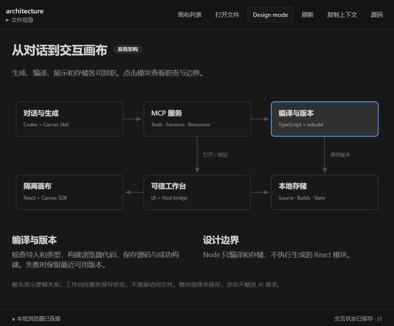
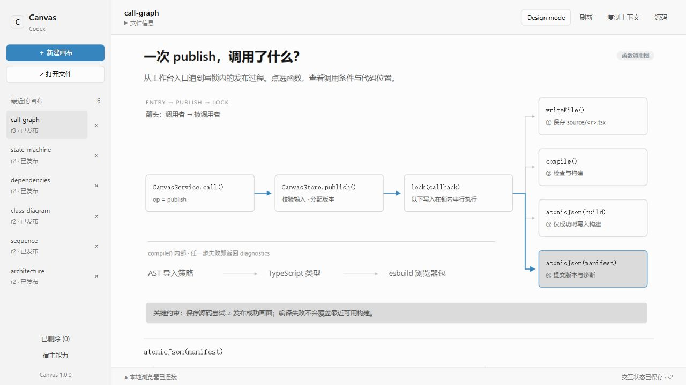
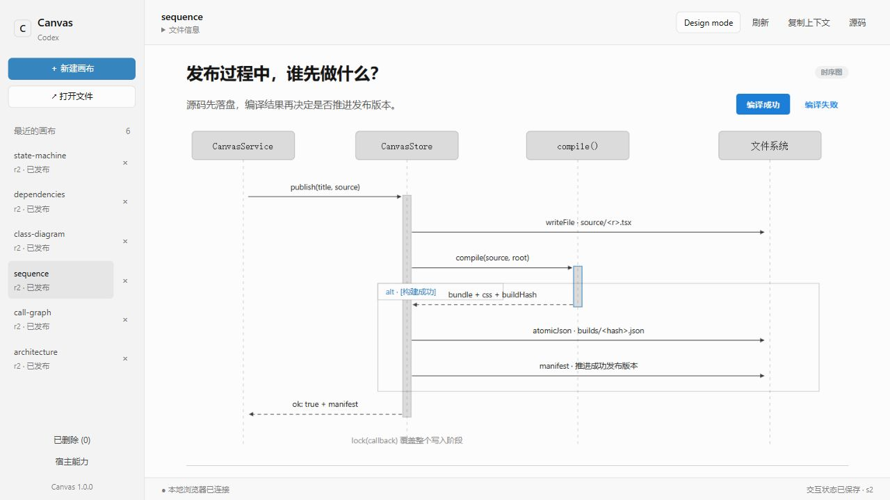
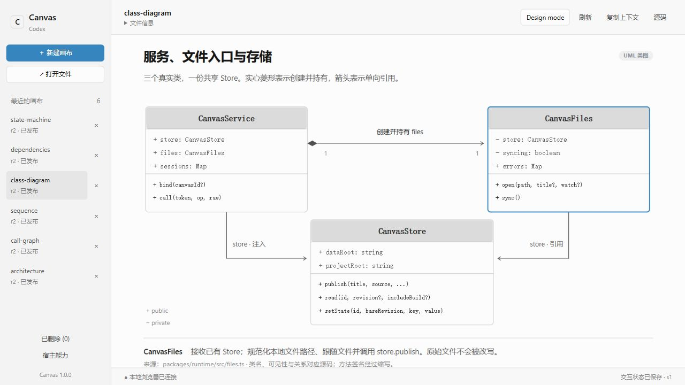
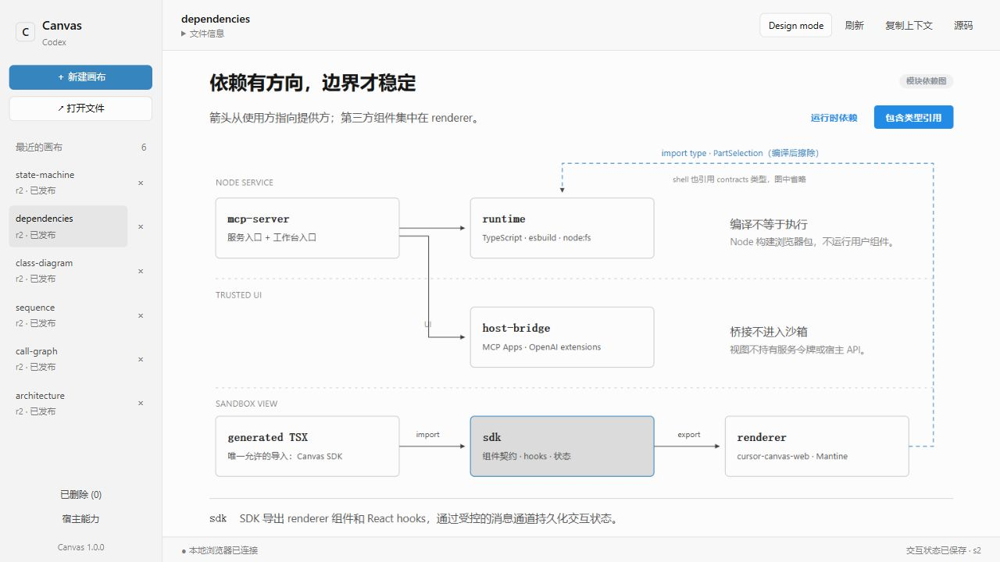
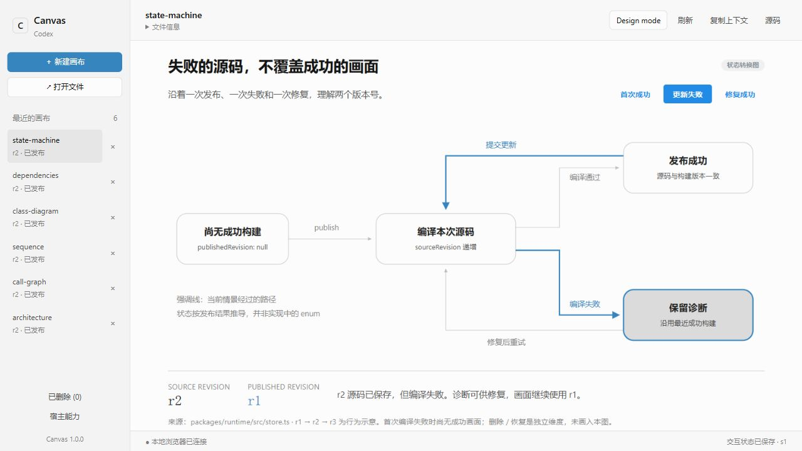
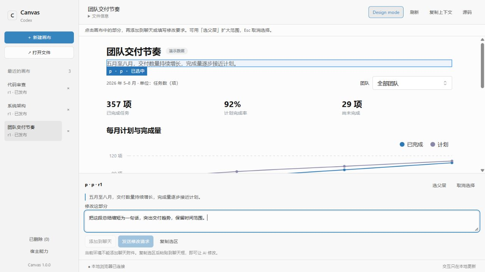

<div align="center">

# Codex Canvas

### Turn answers into canvases you can explore.

Explore function calls, sequences, class relationships and system architecture in Codex. Select a part and refine it in natural language.

[中文](README.md) · **English**

[](CHANGELOG.md)
[](LICENSE)
[](package.json)

[Download release](https://github.com/payAgain/codex-canvas/releases/latest) · [Gallery](#gallery) · [Quick start](#quick-start) · [Install in Codex](#install-in-codex) · [How it works](#how-it-works) · [Contribute](#contribute)

</div>



<p align="center"><em>Actual running UI · Source-derived architecture · Local browser mode</em></p>

Codex Canvas is an open-source plugin for **Codex desktop**. It uses MCP Apps to display canvases in supported host side panels, with a standalone local browser preview also available. Source, revisions and interaction state are stored locally, so a canvas can be reopened, explored and edited over time.

## Gallery

**Six diagrams for everyday software development, each runnable and interactive.** The examples use Codex Canvas itself as the subject: follow its function calls, inspect its classes and explore its runtime boundaries. Click an image to enlarge it, or open the TSX file to interact.

| Function call graph | Sequence diagram |
|:---|:---|
| [](docs/assets/example-call-graph.jpg) | [](docs/assets/example-sequence.jpg) |
| Follow the publish entry point; select a function for conditions and source locations.<br>[View source →](examples/call-graph.tsx) | Switch between successful and failed compilation to compare writes and responses.<br>[View source →](examples/sequence.tsx) |
| **UML class diagram** | **System architecture** |
| [](docs/assets/example-class-diagram.jpg) | [](docs/assets/example-architecture.jpg) |
| Inspect real attributes, methods, composition and references; select a class for its role.<br>[View source →](examples/class-diagram.tsx) | Trace code, state and selections across explicit execution boundaries.<br>[View source →](examples/architecture.tsx) |
| **Module dependencies** | **State transitions** |
| [](docs/assets/example-dependencies.jpg) | [](docs/assets/example-state-machine.jpg) |
| Explore layering and toggle type references that disappear after compilation.<br>[View source →](examples/dependencies.tsx) | Switch between first success, failed update and recovery to compare revisions.<br>[View source →](examples/state-machine.tsx) |

These are screenshots of running canvases with Chinese labels. Relationships are derived from source with stated simplifications; the state view is conceptual and its revision numbers are illustrative. These are editable examples, not a continuously synchronized code index. See the [example guide](examples/README.md) for opening instructions, prompts and additional report, chart and review examples.

## Explore it. Then refine it together.

- **Explore beside the conversation** — Native panels on supported hosts, local browser previews, and light / dark themes.
- **Edit a specific part** — Design mode lets you select an element or its parent and attach an instruction.
- **Open TSX / JSX files** — Use single-file canvases built with the SDK; file watching updates the preview when source changes.
- **Keep progress and state** — Filters persist per canvas. Source is versioned, and failed compilation preserves the latest successful view.
- **Manage a local library** — Close the library drawer directly; create, reopen, restore or permanently delete canvases after confirmation. External source files are preserved.

### Design mode: point to it, then describe the change



Enable **Design mode → select content → enter an instruction**. Supported hosts can attach the selection to chat or send an edit request. In browser mode, copy the selection context and paste it into chat. Normal filters and selections do not start AI turns.

*Browser-mode screenshot: native chat actions are disabled without host messaging support. The pictured request was not sent.*

## Quick start

Requires **Node.js 22+** and **pnpm 11.25.0**. Clone the repository and start your first example:

```sh
git clone https://github.com/payAgain/codex-canvas.git
cd codex-canvas
npm install --global pnpm@11.25.0
pnpm install --frozen-lockfile
pnpm build
pnpm canvas open examples/architecture.tsx --browser
```

The `--browser` flag explicitly starts a standalone browser example. Open its printed local preview URL, or substitute `examples/call-graph.tsx`, `examples/sequence.tsx` or another example path. Use `pnpm start` for the standalone browser workbench. In Codex chats, canvases must open through the native plugin tools below.

### Use it in Codex

After installing the plugin, describe the content you want:

> Open the canvas through the Codex Canvas native MCP App panel. Use canvas_open_file, canvas_open or canvas_publish. Do not open a browser or localhost preview, or use CLI open / --serve as a fallback. If native tools or the connection are unavailable, preserve the source, explain the concrete failure and stop the opening step.

> Read this project and trace the key function calls from its request entry point. Selecting a function should reveal its responsibilities and source location. Label error paths and do not invent calls.

> Open this TSX file with Codex Canvas and follow my subsequent source edits.

> Draw an interactive sequence diagram for this endpoint, including calls and returns, with success, timeout and retry paths. Explain the involved classes and interfaces in a UML class diagram.

The bundled [Canvas Skill](skills/canvas/SKILL.md) requires native plugin delivery. MCP processes do not start browser servers or return browser links; an unavailable native connection stops the opening step instead of triggering a fallback. You can also use the native workbench's file picker. **Ordinary file links in chat may open an external editor; use the Canvas plugin opening tools.**

## Install in Codex

Requires **Node.js 22+**, **Codex desktop with plugin support** and a **Codex CLI** that provides `codex plugin`.

Download `codex-canvas-1.1.1-portable.zip` and `SHA256SUMS.txt` from the [latest Release](https://github.com/payAgain/codex-canvas/releases/latest). The same ZIP works on Windows, macOS and Linux and includes the built workbench, SDK, examples and dependency lockfile. Extract it into a permanent directory and run from the extracted root:

```sh
cd plugins/codex-canvas
npm ci --omit=dev --ignore-scripts --no-audit --no-fund
cd ../..
codex plugin marketplace add . --json
codex plugin add codex-canvas@codex-canvas-local --json
```

To generate an installation package from source, build above and then run:

```sh
pnpm package:release
node scripts/check-package.mjs
```

Change into the printed **`releaseRoot`** directory, then register and install:

```sh
codex plugin marketplace add . --json
codex plugin add codex-canvas@codex-canvas-local --json
```

<details>
<summary>PowerShell: how do I enter releaseRoot?</summary>

Run from the repository root:

```powershell
$release = Get-Content .local/latest-release.json -Raw | ConvertFrom-Json
Set-Location $release.releaseRoot
```

`releaseRoot` is the generated marketplace directory, not the repository root. `check-package` installs locked dependencies and checks MCP startup and example compilation.

</details>

<details>
<summary>Already have portable.zip?</summary>

Extract it into a directory you intend to keep. From `plugins/codex-canvas/`, run:

```sh
npm ci --omit=dev --ignore-scripts --no-audit --no-fund
```

Return to the extraction root containing `INSTALL.md` and `.agents/`, then run the two `codex plugin` commands above. The portable archive excludes `node_modules`; dependency installation needs internet access.

</details>

Enable the plugin and start a new chat. If an existing chat still uses an older service, reload the plugin or restart Codex. See the [release guide](docs/RELEASING.md) for installation and upgrade details.

**Current release:** [v1.1.1](https://github.com/payAgain/codex-canvas/releases/tag/v1.1.1), with a portable installation ZIP, SHA-256 checksums and installation instructions. Publication follows Windows, Linux and macOS build, 22 regression and package checks. Native UI and chat capabilities depend on the host. See the [release notes](docs/releases/1.1.1.md) and [historical acceptance record](docs/releases/1.0.0.md).

## How it works

### One source file, three runtime boundaries

The architecture image above is itself a [runnable canvas](examples/architecture.tsx). It groups modules by execution environment; selecting one reveals its responsibilities and source location.

| Boundary | Responsibilities | Constraint |
|---|---|---|
| Local Node service | Validation, type checking, bundling, revisions and file storage | Compiles generated modules; does not execute generated React code |
| Trusted workbench | Host bridge, canvas navigation, diagnostics, selections and state | Keeps service tokens and host APIs in the trusted shell |
| Isolated canvas | React views inside a sandbox iframe | Uses SDK components and hooks; no direct Node or host access |

A canvas is a single TSX / JSX file with a default React export, importing only from <code>@codex-canvas/sdk</code>. Third-party components stay behind the renderer adapter. Explore publishing and revision retention through the [sequence](examples/sequence.tsx) and [state](examples/state-machine.tsx) examples.

### How a targeted edit works

1. Select an element in Design mode and describe the change.
2. On an explicit send action, the workbench includes the selection, canvas identity and current revisions.
3. Codex reads the current source, edits the relevant part and submits a revision.
4. Successful compilation updates the view. Failure returns diagnostics and keeps the latest successful view.

Sending requires host messaging support; browser mode uses copied context. Normal filters only save local state and do not start AI turns. Selections include DOM, text and optional part identifiers, not general AST mapping. Revision checks prevent stale edits from overwriting newer content.

Read more: [Architecture and data flow](docs/ARCHITECTURE.md) · [SDK components and state](docs/SDK.md) · [Security boundaries](SECURITY.md)

## Data and upgrades

Version 1.1.0 stores the library in a stable directory under Codex plugins:

| Windows | macOS | Linux |
|---|---|---|
| `%USERPROFILE%/.codex/plugins/codex-canvas/data` | `~/.codex/plugins/codex-canvas/data` | `~/.codex/plugins/codex-canvas/data` |

**Open file** starts in its `canvases/` directory. Browse saved or deleted canvases, restore and open a deleted canvas, copy a source path, or reveal the directory in the system file manager. File information shows the current source revision's location.

Close the library drawer with its × button or Esc. **Permanently delete** appears only in the deleted list and requires the complete canvas title. It removes that canvas's source history, builds, interaction state and feedback from the current library. External TSX / JSX files and legacy migration backups remain; the current library cannot restore the canvas.

The first use migrates an existing legacy library while preserving identities, history, state and deletion status. The original directory is retained. `CODEX_HOME` relocates the default under its `plugins/codex-canvas/data`; `CANVAS_DATA_DIR`, `--data-dir` and an explicit `dataDirectory` take precedence. Source development uses the same default; `package:local` retains the old development directory.

The **Theme** control offers Bright, Paper, Mist, Graphite, Midnight and Follow host. The workbench and canvas switch together, and the choice persists in `preferences.json`. Back up the entire data directory. Preview URLs and ready files contain local session credentials and should not be shared. See [SECURITY.md](SECURITY.md) and [the update record](docs/tasks/P1-LIBRARY-THEMES.md).

## Documentation

| Get started | Understand and extend | Maintain |
|---|---|---|
| [Usage and troubleshooting](docs/QUICKSTART.md) | [SDK contract](docs/SDK.md) | [Contributing](CONTRIBUTING.md) |
| [Development diagrams and more](examples/README.md) | [Architecture](docs/ARCHITECTURE.md) | [Releasing](docs/RELEASING.md) |
| [Compatibility and limitations](docs/releases/1.0.0.md) | [Canvas Skill](skills/canvas/SKILL.md) | [Changelog](CHANGELOG.md) |

## Contribute

Contributions are welcome: useful canvases, reproducible bugs, interaction improvements, documentation and platform compatibility evidence. Include versions, reproduction steps and a minimal example without private data. Discuss larger changes in an Issue first; see [CONTRIBUTING.md](CONTRIBUTING.md) for the workflow.

```sh
pnpm build             # Build the workbench and plugin
pnpm start             # Local development preview
pnpm check             # Types, build, regression and release checks
pnpm package:release   # Generate a portable marketplace
```

Near-term work focuses on platform compatibility, source selection mapping and edit diff previews. History UI, backup migration and export remain planned; see the [roadmap](docs/ROADMAP.md). If the project is useful to you, consider starring it or sharing a canvas.

## License and acknowledgments

[MIT License](LICENSE). Thanks to `cursor-canvas-web`, React, Mantine, Recharts, MCP Apps and the other projects listed in [THIRD_PARTY_NOTICES.md](THIRD_PARTY_NOTICES.md).

Codex Canvas takes interaction inspiration from Cursor Canvas. It is an independent community project, unaffiliated with OpenAI or Cursor.
