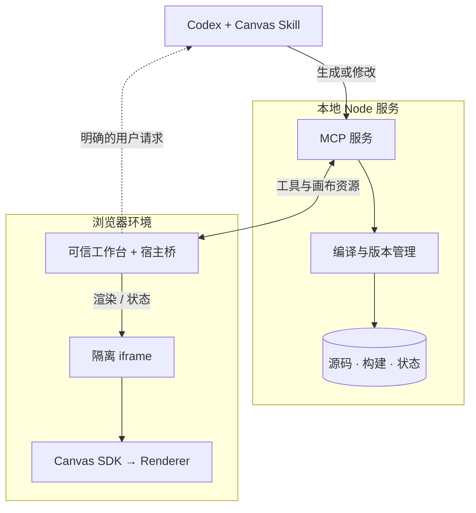
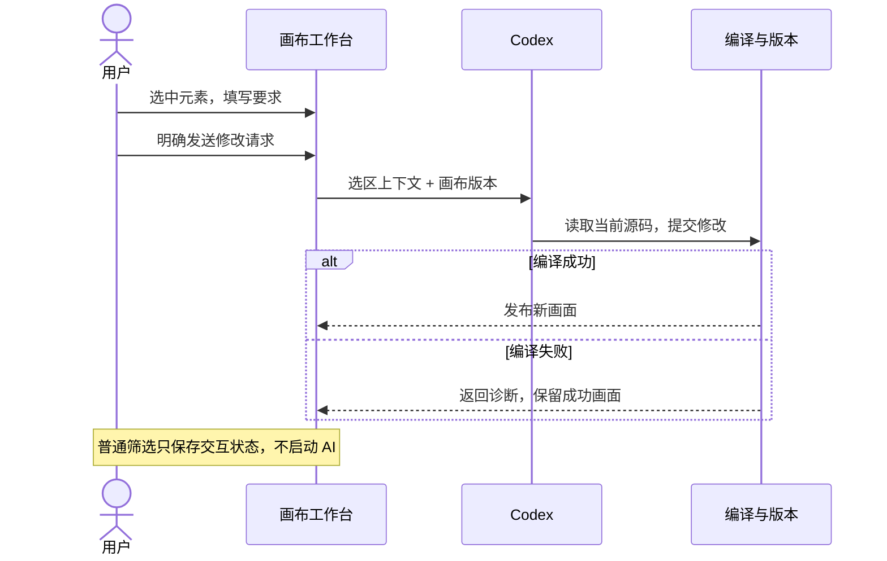

<div align="center">

# Codex Canvas

### 把回答变成可以探索的画布。

在 Codex 中生成交互式报告、图表和架构说明，选中一部分，继续用自然语言修改。

**中文** · [English](README.en.md)

[](CHANGELOG.md)
[](LICENSE)
[](package.json)

[示例画廊](#示例画廊) · [快速开始](#快速开始) · [安装到 Codex](#安装到-codex) · [工作原理](#工作原理) · [参与贡献](#参与贡献)

</div>


<p align="center"><em>实际运行截图 · 内置演示数据 · 本地浏览器模式</em></p>

Codex Canvas 是面向 **Codex 桌面端**的开源插件。通过 MCP Apps，画布可以显示在支持的宿主侧边面板中；也可以在本地浏览器独立运行。源码、版本和交互状态保存在本地，一张画布可以反复打开、探索和编辑。

## 示例画廊

**六种场景，六份可运行源码。** 点击图片放大，点击源码查看实现。你可以直接打开这些文件，也可以把它们交给 Codex，替换成自己的内容。

| 数据报告 | 系统架构 |
|:---|:---|
| [](docs/assets/example-report.jpg) | [](docs/assets/example-architecture.jpg) |
| 按团队筛选，联动查看指标、趋势与明细。<br>[查看源码 →](examples/report.tsx) | 点击模块，查看职责与实现边界。<br>[查看源码 →](examples/architecture.tsx) |
| **方案对比** | **项目排期** |
| [](docs/assets/example-comparison.jpg) | [](docs/assets/example-roadmap.jpg) |
| 切换个人工具 / 协作应用，理解取舍与建议。<br>[查看源码 →](examples/comparison.tsx) | 用时间条展示计划，按状态筛选、点击阶段查看详情。<br>[查看源码 →](examples/roadmap.tsx) |
| **常用统计图** | **代码审查** |
| [](docs/assets/example-charts.jpg) | [](docs/assets/example-review.jpg) |
| 切换时间范围，联动更新柱状图、环形图和统计。<br>[查看源码 →](examples/charts.tsx) | 按严重程度筛选，查看发现、涉及文件与建议。<br>[查看源码 →](examples/review.tsx) |

画廊展示真实运行的画布区域。报告和图表使用虚构数据；排期、选型与审查是教学示例，不代表真实项目承诺或评测结论。更多使用提示见 [示例说明](examples/README.md)。

## 从查看，到一起修改

- **在聊天旁探索内容** — 支持原生侧边面板与本地浏览器预览，明暗主题随宿主切换。
- **只修改你选中的部分** — Design mode 支持点选元素、选择父层，再附上修改要求。
- **打开已有 TSX / JSX** — 使用 SDK 格式的单文件画布；开启文件跟随后，保存源码即可更新预览。
- **保存进度与交互** — 筛选状态按画布保存；源码保留版本，编译失败时保留最近成功画面。
- **管理自己的画布库** — 创建、重新打开、删除与恢复；删除画布不会删除外部源文件。

### Design mode：指出哪里，再说明怎么改


打开 **Design mode → 点击内容 → 输入要求**。宿主支持时，可以添加选区上下文到聊天或发送修改请求；浏览器模式可以复制选区后粘贴到聊天。普通筛选和点选不会启动 AI。

*截图来自浏览器模式：原生聊天按钮因缺少宿主消息能力而禁用，修改要求未发送。*

## 快速开始

需要 **Node.js 22+** 与 **pnpm 11.25.0**。克隆仓库并启动第一个示例：

```sh
git clone https://github.com/payAgain/codex-canvas.git
cd codex-canvas
npm install --global pnpm@11.25.0
pnpm install --frozen-lockfile
pnpm build
pnpm canvas open examples/report.tsx
```

打开命令输出的本地预览链接，即可操作第一张画布。换成 `examples/architecture.tsx`、`examples/charts.tsx` 等路径，就能体验其他示例；`pnpm start` 打开完整工作台。

### 在 Codex 中使用

安装插件后，直接描述你需要的内容：

> 用 Codex Canvas 把这份交付数据做成报告：先给一句结论，再展示指标、趋势和明细，支持按团队筛选。保留来源，不要补造数据。

> 用 Codex Canvas 打开这个 TSX 文件，并跟随我后续的源码修改。

> 把这两个方案做成可交互的对比画布，按使用场景给出建议，并列出依据与不确定项。

内置 [Canvas Skill](skills/canvas/SKILL.md) 会引导 Codex 编写、发布和打开画布。也可以点击工作台的「打开文件」。**聊天中的普通文件路径链接由 Codex 决定打开方式，可能打开外部编辑器；预览请使用 Canvas 的打开入口。**

## 安装到 Codex

需要支持插件的 **Codex 桌面端**，以及提供 `codex plugin` 命令的 **Codex CLI**。完成上方构建后：

```sh
pnpm package:release
node scripts/check-package.mjs
```

进入输出的 **`releaseRoot`** 目录，再注册并安装：

```sh
codex plugin marketplace add . --json
codex plugin add codex-canvas@codex-canvas-local --json
```

<details>
<summary>PowerShell：如何进入 releaseRoot？</summary>

在仓库根目录执行：

```powershell
$release = Get-Content .local/latest-release.json -Raw | ConvertFrom-Json
Set-Location $release.releaseRoot
```

`releaseRoot` 是生成的 marketplace 目录，不是仓库根目录。`check-package` 会安装锁定依赖，并检查 MCP 启动和示例编译。

</details>

<details>
<summary>已经取得 portable.zip？</summary>

解压到长期保留的目录，在 `plugins/codex-canvas/` 中运行：

```sh
npm ci --omit=dev --ignore-scripts --no-audit --no-fund
```

回到包含 `INSTALL.md` 与 `.agents/` 的解压根目录，再执行上面的两条 `codex plugin` 命令。可移植包不包含 `node_modules`，首次安装依赖需要联网。

</details>

启用插件后开始新聊天。如果当前聊天仍使用旧服务，重新加载插件，必要时重启 Codex。安装、升级和发布细节见 [发布指南](docs/RELEASING.md)。

**当前状态：** 源码已在 GitHub 公开，首次 GitHub Release 尚未发布。1.0.0 已在 Windows x64 完成本地验收；跨平台 CI 检查构建与协议，Linux / macOS 原生界面仍待验证。原生面板和聊天操作取决于宿主能力，完整范围见 [验收记录](docs/releases/1.0.0.md)。

## 工作原理

### 一份源码，清晰的运行边界



画布是默认导出 React 组件的单文件 TSX / JSX，只从 `@codex-canvas/sdk` 导入。Node 服务负责编译和存储，生成代码在隔离 iframe 中执行。第三方组件封装在 `renderer` 后面，宿主消息能力由可信工作台管理。

### 一次局部修改如何完成



发送选区需要宿主消息能力；浏览器模式用复制上下文完成交接。选区提供 DOM、文本及可选 part 标识，尚不是通用 AST 定位。版本检查用于避免旧修改覆盖新内容。

深入了解：[架构与数据流](docs/ARCHITECTURE.md) · [SDK 组件与状态](docs/SDK.md) · [安全边界](SECURITY.md)

## 数据与更新

正式可移植安装使用独立的用户数据目录，升级插件不会把画布放进新的插件缓存：

| Windows | macOS | Linux |
|---|---|---|
| `%LOCALAPPDATA%/CodexCanvas` | `~/Library/Application Support/CodexCanvas` | `$XDG_DATA_HOME/codex-canvas`，默认 `~/.local/share/codex-canvas` |

源码开发默认使用 `.canvas-data/`；`CANVAS_DATA_DIR` 或 `--data-dir` 可指定位置。备份请复制整个数据目录。预览 URL 和 ready 文件包含本地会话凭据，请勿公开；数据处理边界见 [SECURITY.md](SECURITY.md)。

## 文档导航

| 开始使用 | 理解与扩展 | 维护项目 |
|---|---|---|
| [使用与排错](docs/QUICKSTART.md) | [SDK 契约](docs/SDK.md) | [贡献指南](CONTRIBUTING.md) |
| [六个完整示例](examples/README.md) | [架构设计](docs/ARCHITECTURE.md) | [发布指南](docs/RELEASING.md) |
| [兼容性与已知限制](docs/releases/1.0.0.md) | [Canvas Skill](skills/canvas/SKILL.md) | [更新日志](CHANGELOG.md) |

## 参与贡献

欢迎贡献实用画布、复现问题、改进交互与文档，或补充不同平台的兼容记录。提交问题时，请附版本、复现步骤和移除私人数据的最小示例。较大改动建议先通过 Issue 讨论；具体流程见 [CONTRIBUTING.md](CONTRIBUTING.md)。

```sh
pnpm build             # 构建工作台与插件
pnpm start             # 本地开发预览
pnpm check             # 类型、构建、回归与发布检查
pnpm package:release   # 生成可移植 marketplace
```

近期方向是平台兼容、局部源码定位与修改 Diff 预览。历史撤回、备份迁移和导出仍在规划中，详见 [路线图](docs/ROADMAP.md)。如果这个项目对你有用，欢迎 Star 或分享你的画布。

## 许可证与致谢

[MIT License](LICENSE)。感谢 `cursor-canvas-web`、React、Mantine、Recharts 和 MCP Apps 等开源项目，第三方声明见 [THIRD_PARTY_NOTICES.md](THIRD_PARTY_NOTICES.md)。

Codex Canvas 参考了 Cursor Canvas 的交互体验，是独立开发的社区项目，与 OpenAI、Cursor 无官方隶属关系。
