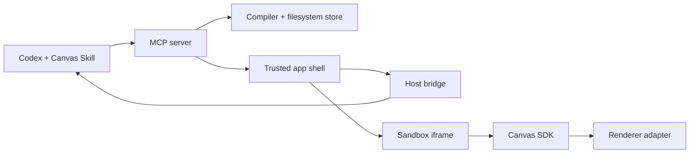

# 架构

状态：1.0.0 实现。日期：2026-10-10。

## 模块边界



| 模块 | 运行环境 | 职责 |
|---|---|---|
| `sdk` | 生成视图 | 组件、React hooks 和持久状态接口 |
| `renderer` | 生成视图 | 第三方组件适配、主题、渲染边界、Design mode 描边 |
| `host-bridge` | 可信外壳 | MCP Apps、实际宿主能力、主题和明确消息操作 |
| `runtime` | Node | 类型检查、浏览器打包、版本/状态/反馈存储、文件跟随 |
| `mcp-server` | Node / 可信外壳 | MCP 与 HTTP、会话绑定、工具和 UI 资源 |

生成模块只导入 `@codex-canvas/sdk`。Node 编译器不执行生成模块。可信外壳和宿主桥不进入生成代码的执行上下文。

## 身份、版本和存储

```text
data/
  workspace.json
  .write.lock
  canvases/<canvasId>/
    manifest.json
    state.json
    source/<sourceRevision>.tsx
    builds/<sha256>.json
    feedback/<feedbackId>.json
  probes/<probeId>.json
```

- `canvasId` 是服务端生成的稳定 UUID，`workspaceId` 标识数据目录。
- `sourceRevision` 记录源码尝试；`publishedRevision` 和 `buildHash` 指向最近成功编译版本。
- `stateRevision` 独立增长。源码修改保留交互状态，状态写入通过乐观锁处理冲突。
- 写操作使用跨进程文件锁，JSON 使用临时文件与 rename 提交。它不是数据库，不承诺断电恢复或备份。
- 删除设置 `deletedAt`，默认读取和文件跟随排除删除对象；恢复保留身份、历史和状态。外部 TSX 文件不删除。
- 源文件映射保存规范路径、内容哈希和导入版本。独立编辑后检测冲突，不覆盖画布内的修改。

## 发布和显示

源码先检查导入策略与 TypeScript，再用 esbuild 输出浏览器 JS/CSS。成功构建后更新 manifest；失败仍保存源码与诊断，保留成功构建。可信外壳先创建候选 iframe，收到 `render-ready` 后才替换同一画布的旧视图。

iframe 只启用 `allow-scripts`，没有 `allow-same-origin`。CSP 禁止网络、嵌套 iframe 和表单。状态/选区消息必须匹配窗口来源、随机 channel 和当前画布。它不是独立 CPU 隔离系统。

更新通过轮询发现。主题变化才重建生成视图，尺寸通知不会反复重载。原生扩展面板填充宿主容器，聊天内回退有固定高度并禁用自动尺寸反馈。

## 宿主与升级

主 MCP 服务名固定为 `codex-canvas`，UI 资源 URI 带发布版本。安装包为早期版本保留两个仅供 App 的兼容服务名和历史资源地址，避免旧卡片断开。兼容进程不启动文件 watcher，主服务负责文件跟随。

每个界面获得独立服务端令牌及显式画布绑定。原生界面恢复时通过当前 MCP 连接获取新令牌，不使用历史工具结果中的过期令牌。UI 请求串行处理；只有服务端在执行前拒绝的 `INVALID_SESSION` 会重连并重试一次，不重放结果未知的写请求。

原生 `fullscreen` 在本机表现为侧边面板，具体位置由宿主控制。thread/file 入口和消息扩展按文档注册，但能力声明、协议测试与实际 UI 观察分别记录。浏览器回退不具备原生聊天能力。

## 局部修改

Design mode 在隔离视图内选取 DOM 元素，携带限长路径、文本、标签和可选 `data-canvas-part`。选择本身不发送消息。用户明确操作后，可信外壳请求服务端校验源码/发布版本并保存反馈，再调用宿主上下文或消息接口。

源码位置只在发布源码中存在唯一精确文本匹配时返回，不是通用 AST 映射。切换或刷新视图清空旧选区。Agent 仍须重新读取当前版本；文件跟随画布优先编辑原文件，其余画布用带基线版本的 `canvas_update`。

更多：[安全边界](../SECURITY.md)、[宿主历史观察](compatibility/2026-10-10-upgrade-identity.md)、[1.0.0 检查结果](releases/1.0.0.md)。
